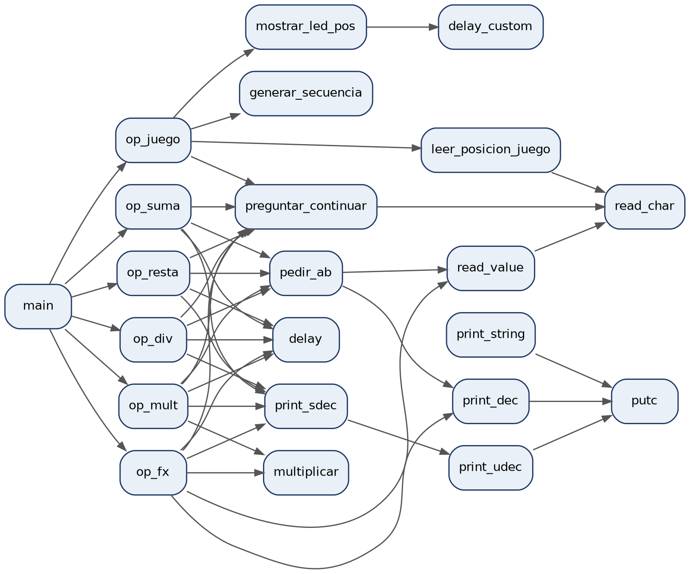

# Calculadora en ensamblador Nios II

Calculadora interactiva escrita completamente en ensamblador Nios II, con un juego de memoria en los LEDs. Corre en el simulador CPUlator (sistema DE2-115) y se usa desde la terminal JTAG UART.

Reto 2 de **Estructura del Computador 1** (Universidad del Norte, 2026).

**Autores:** Daniel García, Victor Mendoza y Jesús Contreras

## Qué hace

| Opción | Operación |
|---|---|
| 1 | Suma A + B |
| 2 | Resta A − B, con signo si el resultado es negativo |
| 3 | Multiplicación por sumas repetidas (sin la instrucción MUL) |
| 4 | División entera con cociente y residuo, por restas repetidas; maneja la división por cero |
| 5 | Función cuadrática F(x) = ax² + bx + c |
| 6 | Juego de memoria: los LEDs muestran una secuencia de 5 posiciones y hay que repetirla |
| 0 | Salir |

- Los operandos se ingresan con una sola tecla en hexadecimal (0–9, A–F), del 0 al 15.
- Cualquier entrada inválida se rechaza con un mensaje y se vuelve a pedir; el programa nunca se cae.
- Después de cada operación pregunta si quieres continuar (Y/N).

## Cómo funciona

- Entrada y salida por **E/S mapeada en memoria** con sondeo (*polling*) de la JTAG UART y los LEDs.
- Subrutinas con marcos de pila explícitos, reutilizables entre operaciones.
- Generador pseudoaleatorio propio para la secuencia del juego.

## Cómo ejecutarlo

1. Entra a [CPUlator](https://cpulator.01xz.net/?sys=nios-de2-115) con el sistema **Nios II DE2-115**.
2. Pega el contenido de `calculadora.s` en el editor.
3. Pulsa **Compile and Load** y luego **Continue**.
4. Escribe en la terminal JTAG UART y mira los LEDs rojos para el juego.

El manual de usuario y el informe técnico, con las pruebas, están en [`docs/informe.pdf`](docs/informe.pdf).
